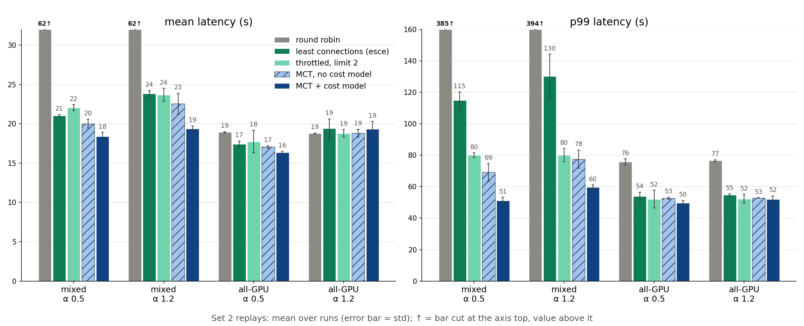
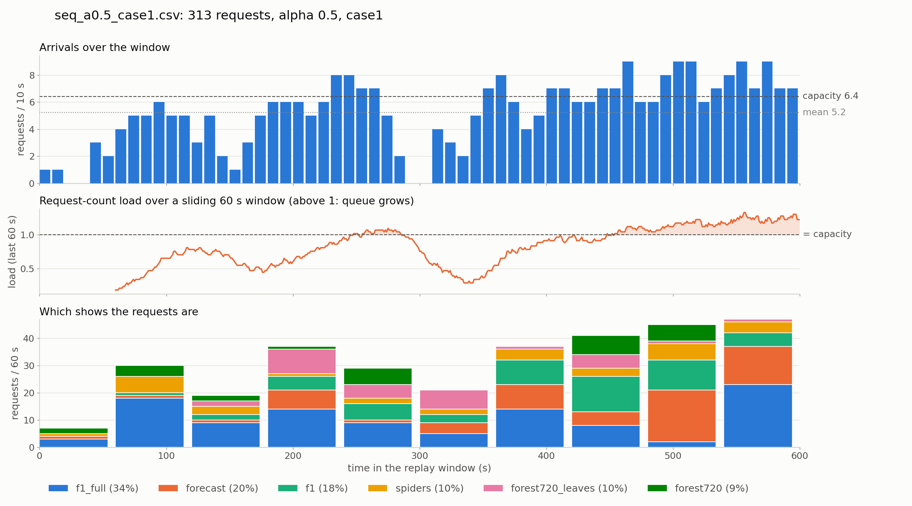
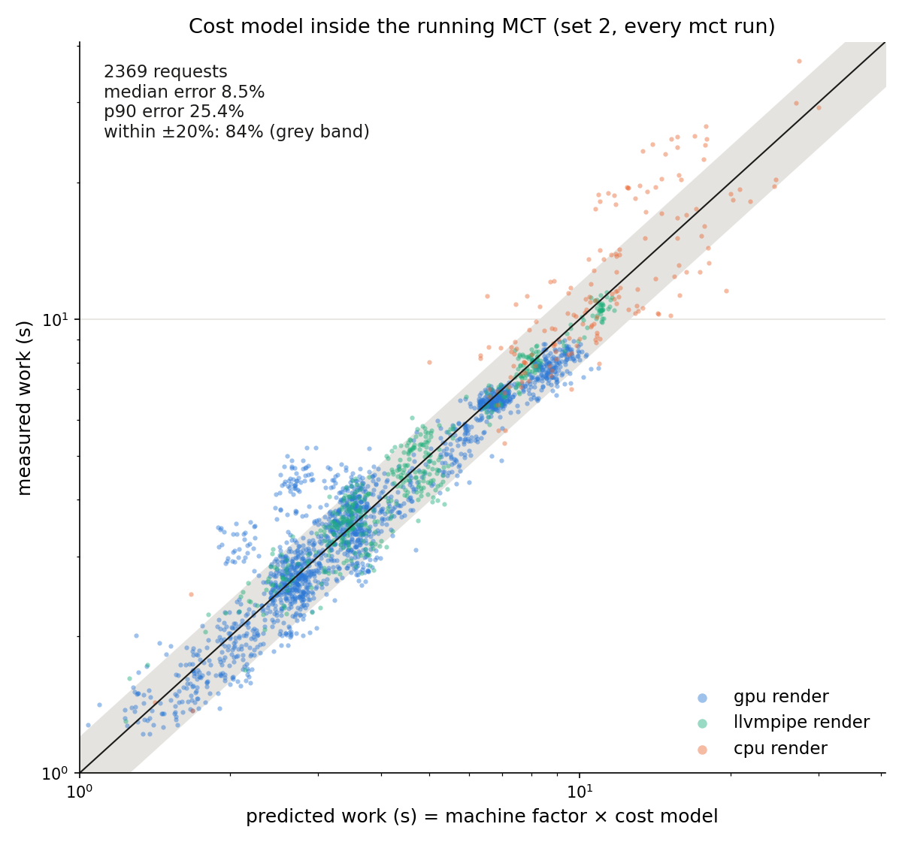
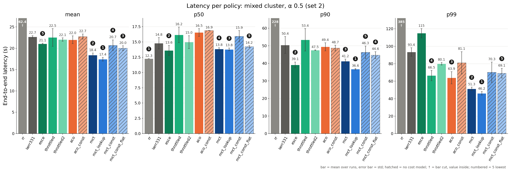
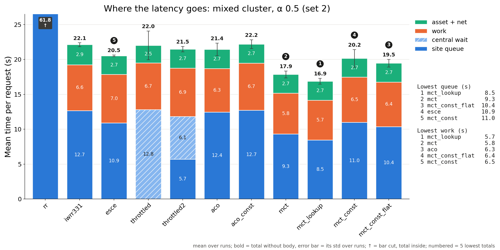

# Compute Offload Framework for Cloud/Edge Media Rendering in Object-Based Media

Third-year project, supervised by Barry Porter (October 2026 – March 2027).

**Object-Based Media (OBM)** keeps the objects of a video (camera feeds, graphics, captions, a weather presenter)
separate until delivery, so each viewer can choose their own combination. Compositing that combination in the
browser's WebAssembly player needs considerable computing power on the viewer's device. An **offload framework**
moves the work to the server side: an offload site decodes the layers, composes them and encodes the chosen
combination as a 10-second H.264 segment.

Rendering per request is expensive and very uneven. Cost depends on the site's hardware (GPU, software rasteriser
or plain CPU, near or far) and on the chosen layers: a light 2D overlay takes milliseconds on a GPU, full-frame chroma
keying takes seconds on a CPU. Viewers are impatient: abandonment rises by about 5.8% for every second of startup
delay beyond 2 s (Krishnan & Sitaraman), and popularity is heavily skewed towards a few videos and default
combinations (Cha et al.).

**Goal:** minimise viewer-perceived latency while keeping the offload sites reasonably utilised, under realistic
workloads, by studying two levers:

1. **Load balancing**: which offload site should render each request? *(done, results below)*
2. **Computational optimisations**: avoiding repeated work with segment / asset caching, request coalescing,
   proactive prediction and partial segment caching. *(next, see [Project plan and status](#project-plan-and-status))*

The method is quantitative: a real distributed OBM system on a controlled testbed, a discrete-event simulator for
scale, and analysis of the trade-offs between latency, utilisation and cache cost.

### Load balancing results at a glance

- **Minimum Completion Time + a learned cost model is the best policy**: on the mixed GPU / CPU cluster it cuts mean
  latency by **2.7–4.5 s (13–19%)** against the standard policies (least connections, throttled, weighted round
  robin) and p99 latency from **80–130 s to 51–60 s**; against plain round robin it is **3.4× / 7.5×** lower (mean / p99).
- **The cost model predicts render work from metadata alone**: 12% error on unseen request kinds, 18% on unseen shows,
  8.5% median error live inside the load balancer.
- **Cost awareness matters when hardware differs**: on identical GPU sites every reasonable policy is within ~1 s.
- 46 replays on real hardware, 0 failed requests; run-to-run noise ~0.8 s on the mean.



> Full operating manual (architecture, host requirements, cluster setup, every config file):
> [breakdown.md](breakdown.md)

---

## What I built

| Part | What it does | Where |
|---|---|---|
| Main server (Rust, `smol`) | serves the web client, assets and show specs; reverse proxy + load balancer for `/offload/...` render requests | `rust_server/src/main_server.rs` |
| Load balancer library (Rust) | one trait, 11 policies, per-site feedback (`X-Dana-Timings`), async wait queue | `rust_obm/src/mod_load_balancer/` |
| Offload site (Rust + Dana) | container per render site: FIFO job queue in front of the unmodified Dana OBM engine; decode `gpu`, render `gpu` / `llvmpipe` / `cpu`, encode `cpu` | `rust_server/src/offload_server.rs`, `servers_container/` |
| Cost model (Python → Rust) | predicts a request's render work from generic metadata only, no show name | `stat_predict/`, `rust_obm/src/cost_predict.rs` |
| Workload generator | viewer model (Zipf popularity, surfing / leaving, player buffering) → open-loop request sequences at a target load | `servers_benchmark/generate_request_seq.py` |
| Replay benchmark + analysis | replays a sequence against the cluster, records per-request timing breakdown, plots | `servers_benchmark/seq_bench.py`, `stat/` |
| Synthetic shows | ffmpeg-generated shows that fill gaps in the BBC data (chroma area, resolution, stream count) | `syn_video/` |

**Testbed:** two identical laptops (i9-13900HX, Intel iGPU) linked by Ethernet. The "near" machine (om) runs the main
server and 2–3 sites at 30 ± 3 ms emulated delay (`netem`); the "far" machine (rs) runs 2–3 sites at 60 ± 6 ms.
Two cluster cases: **mixed** (gpu / llvmpipe / cpu render on each machine) and **all-GPU** (2 gpu sites per machine).
Each sequence is ~300 requests over 600 s at 80% of the cluster's measured capacity, with bursts above capacity;
α = 0.5 spreads views over the shows, α = 1.2 concentrates them.



---

## Highlight 1: MCT with learned site factors

Minimum Completion Time sends each request to the site where it is predicted to **finish first**:

```
site = argmin_s  makespan_s + n_s + f_s × work_est(config_s, request)
```

- `makespan_s`: predicted time until site *s* finishes everything already sent to it (sum of estimates in flight)
- `n_s`: learned asset-loading + network time of the site (seconds)
- `f_s`: learned machine factor (how fast this machine is relative to the reference machine)
- `work_est`: the cost model's prediction for this request on this site's backend

`f` and `n` are learned online from every completed request with an exponentially weighted moving average:

```
n_s ← 0.9 · n_s + 0.1 · (asset + net)
f_s ← 0.9 · f_s + 0.1 · clamp(actual_work / predicted_work, 0.25, 4)
```

No hand tuning is needed: starting every site at `f = 1, n = 1 s` performs the same as hand-set priors (within ±1 s),
because the starting value is forgotten after ~20 completions (0.9²⁰ ≈ 12%). With the cost model the factor learns
only the machine difference (om ≈ 1.0, rs ≈ 0.8, matching the measured 0.71–0.82 speed ratio).

## Highlight 2: a cost model from generic metadata

Render work is split into Dana's three stages, with one small non-negative linear model per (stage, backend):

```
work_est(config, req) = seg_frac × ( decode[config.decode](x) + render[config.render](x) + encode[config.render, config.encode](x) )
each stage:  t = a + Σ βᵢ · xᵢ      a, β ≥ 0   (fitted with NNLS on relative error)
```

The features `x` come from the show's layer graph and asset metadata (decoded megapixels, number of video streams,
screen area that is chroma-keyed, alpha-masked or scaled, moving-video area), so **unseen shows can be predicted**.
The fitted costs are physically sensible: the CPU renderer pays ~6 s before drawing anything, chroma keying costs
~16 s per screen of area on CPU, and scaling video is almost free on the GPU.

| Test | Error |
|---|---|
| unseen request kinds (random 80/20) | 12% mean (no-feature baseline 28%) |
| unseen shows (train on synthetic shows only, test on all BBC shows) | 18% mean |
| live inside the running MCT (machine factor × model, per request) | 8.5% median, 25% p90 |

The synthetic shows matter: with the forecast show held out, a BBC-only model has never seen chroma keying (50% error);
adding the synthetic shows brings it to 17%.



---

## Results

46 replays of the four sequences (every policy twice, least-connections three times), 0 failed requests.
Run-to-run noise is ~0.8 s on the mean and 3–9 s on p99, so gaps of 2–4 s are real and ~1 s gaps are ties.

| Policy (mean / p99 latency, s) | mixed α 0.5 | mixed α 1.2 | all-GPU α 0.5 | all-GPU α 1.2 |
|---|---|---|---|---|
| **MCT + cost model** | **18.4 / 51** | **19.4 / 60** | **16.4 / 50** | 19.3 / 52 |
| MCT + measured lookup table | 17.4 / 46 | 18.9 / 60 | 16.5 / 50 | 18.4 / 50 |
| MCT, constant work estimate | 20.0 / 69 | 22.6 / 78 | 17.1 / 53 | 18.8 / 53 |
| throttled, 2 jobs per site | 22.1 / 80 | 23.7 / 80 | 17.7 / 52 | 18.8 / 52 |
| least connections (esce) | 21.1 / 115 | 23.9 / 130 | 17.4 / 54 | 19.4 / 55 |
| ant colony (aco) | 22.0 / 64 | 24.5 / 82 | 17.7 / 55 | 19.7 / 65 |
| round robin | 62.4 / 385 | 61.9 / 394 | 18.9 / 76 | 18.8 / 77 |



**Where the gain comes from.** Latency splits exactly into queue + work + asset/network + response body. On the mixed
cluster MCT wins on *both* parts a policy controls: less work (better placement, heavy requests kept off CPU sites)
and less queueing (better balancing). Throttling only moves the queue from the sites to the main server.



### Findings

- **Cost-aware placement pays off in proportion to how different the sites are.** On the mixed cluster MCT with the
  cost model beats least connections, throttled and weighted round robin by 2.7–4.5 s mean and cuts p99 from
  80–130 s to 51–60 s. On the all-GPU cluster every reasonable
  policy is within ~1 s; only the tails differ.
- **Better prediction has diminishing returns.** A lookup table of measured times halves the prediction error but
  improves mean latency by only ~1 s. The remaining gap is the cost of not knowing the future, not prediction error.
- **The median misleads.** Round robin has the best p50 on three of four sequences and by far the worst tail: requests
  that land on GPU sites are fast while CPU sites build queues of several minutes.
- **Least connections has a good middle but a fat tail** on mixed hardware: it counts jobs, not seconds, so a slow
  CPU site keeps getting work. Capping each site at two jobs (throttled) fixes most of the tail.
- **Nature-inspired ACO does not help here.** The pheromone mostly learns that some shows are heavy (which cannot
  change a choice), and random exploration costs 2.6–5 s versus MCT; as its β → ∞ it becomes MCT.
- **Distance can outweigh speed.** The far machine renders ~1.3× faster but pays ~1.9 s more asset loading (asset
  loading takes ~50 round trips over the delayed link), so for GPU / llvmpipe sites the "slower" near machine wins.

### How far from optimal?

In a trace simulator, a search over full schedules with perfect knowledge of the future (an NP-hard problem) beats online MCT by ~6–8 s mean, split roughly evenly between prediction error and not knowing future arrivals.

**Recommendation:** MCT with a cost model; without a model, a per-site concurrency cap (throttled, limit 2) for its
tail; least connections only on near-identical sites.

---

## Engineering notes

- **Debugged a restart race in the render engine.** Dana recycles itself after 10 jobs when its queue is empty; a job
  sent in that instant got a connection reset (1 failed request in 30 runs). The offload server now resends a job that
  Dana closed without any response byte (it cannot have rendered it). 0 failures in the 46 runs since.
- **Reproducible workloads:** the generator is seeded; regenerating the current set reproduces it byte for byte, and new
  seeds go to their own folders (`--seed`, `--out-dir`, `seq_bench --run-root`).
- **Every decision is checked:** a log checker verifies after each run that MCT picked the argmin, ACO's probabilities
  match its pheromone table, and throttled never exceeded its limit or let a request overtake.
- **Overnight batches** run unattended with a watchdog (progress, failed requests, containers on both machines,
  temperatures, memory).

## Project plan and status

The project follows the four stages of the proposal ([reports/proposal/main.pdf](reports/proposal/main.pdf)); the
direction is unchanged, a few details changed on the way (below).

| Stage (weeks) | Plan | Status |
|---|---|---|
| 1. Initial scoping (1–2) | system design, offload pipeline, metrics, workload model | done |
| 2. Real-world experiment (3–7) | containerised main server + heterogeneous offload sites, `netem` near / far clusters, load balancing and computational optimisations under generated workloads | **load balancing done**: 11 policies, cost model, repeated replays, second workload seed running. **Computational optimisations: next** |
| 3. Software simulation (8–12) | discrete-event simulator driven by the measured timings, for large clusters and sustained load | trace-simulator prototypes already used (offline bound, policy what-ifs); full simulator (`rust_sim/`) not started |
| 4. Analysis and reflection (13–15) | cross-validate simulator vs testbed, bottleneck analysis, Pareto trade-off of latency, utilisation and cache cost, design recommendations | first bottleneck analysis done (latency decomposition: queueing and asset loading dominate); Pareto analysis after the optimisations |
| 5. Report (16–18) | final report | – |

### Computational optimisations (planned)

| Optimisation | Idea | Groundwork |
|---|---|---|
| Segment and asset caching (LRU / LFU) | reuse rendered segments of popular combinations; cache assets at the offload sites | on-disk cache table written (`rust_obm/src/file_cache.rs`), not wired in; asset loading is ~1.8 s near / ~3.5 s far per request, the largest cost after rendering |
| Request coalescing | one render for identical requests in flight | planned in the main server's request path (hit / miss / in-flight) |
| Proactive request prediction | render the likely next segment before it is asked for | viewer model already predicts continue / switch / leave |
| Partial segment caching (GDSF) | cache the shared, computationally heavy part of a combination (e.g. a chroma-keyed layer) with Greedy Dual Size Frequency, keeping OBM's flexibility at a sensible storage cost | cost model gives the per-layer render cost GDSF needs |

The baseline deliberately stays at a "normal default" level (no cache, no keep-alive), so each optimisation's effect
can be measured on its own with the same replay benchmark and metrics.

### Metrics (as planned)

- client-perceived latency: mean, p50, p90, p99
- latency decomposition from response headers: T_asset, T_queue (site queue + central wait), T_work = T_decode +
  T_render + T_encode, T_offload-RTT, and the client remainder
- offload site utilisation (busy time; workloads are generated at 80% of measured capacity)
- cache cost (storage), once caching is in

### Changes from the proposal

- **Network:** a direct Ethernet link between the two machines with `netem` delay instead of a Tailscale VPN and a
  cloud tunnel: more controlled and repeatable.
- **Policies:** Throttled (a per-site concurrency cap) was added, MCT got three variants (measured lookup table,
  constant work, no priors), and Min-Min / Max-Min are not implemented yet.
- **Workload:** the planned exponential arrivals and Zipf-with-cutoff popularity are kept, inside a viewer-session
  model (segment continuation, switching, leaving, player buffering) fitted to a target load.

## Repository map

```
rust_server/        main server + offload server (Rust)
rust_obm/           load balancer library, cost model and lookup predictors (Rust)
stat_predict/       cost model fitting and evaluation (Python)
servers_benchmark/  sequence generator, replay benchmark, sequences
servers_container/  Docker images, cluster and site configs
syn_video/          synthetic shows
rust_sim/           discrete-event simulator (stage 3, scaffold only)
reports/proposal/   project proposal (plan, background, references)
stat/               replay results and plot scripts (latency_plot.py, latency_detail_plot.py)
highlight/          figures in this README (make_figures.py regenerates them)
breakdown.md        full operating manual
```

The OBM engine (written in Dana) and the BBC shows come from the supervisor's OBM project and are used unmodified;
`obm/` is not in this repository.
